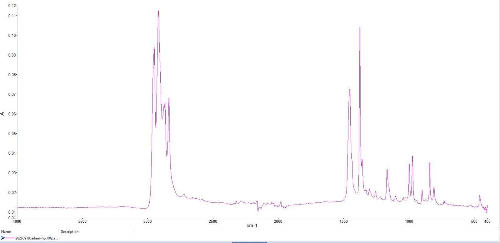
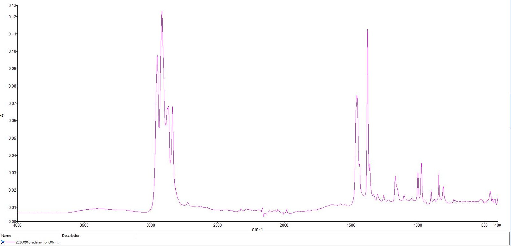
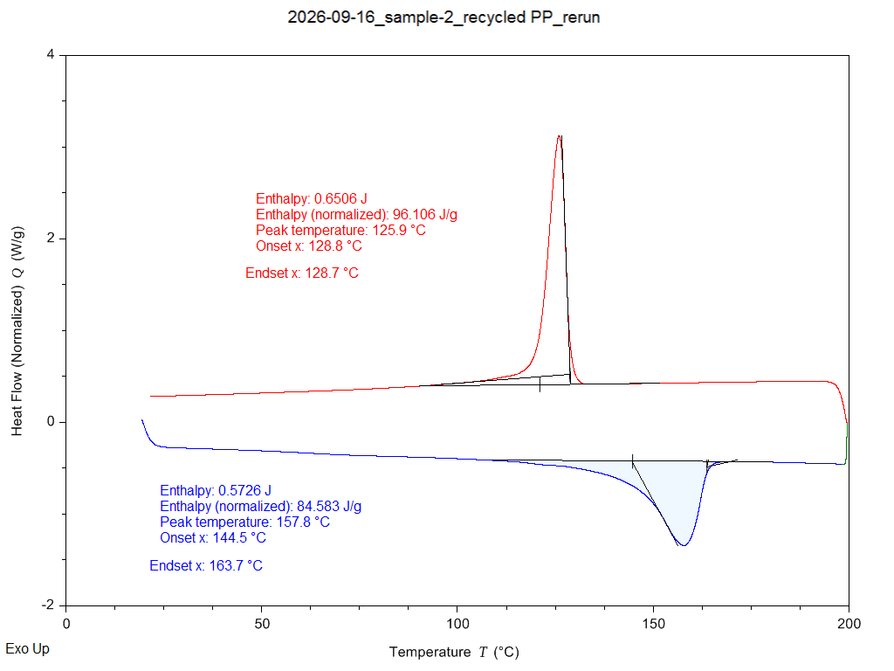
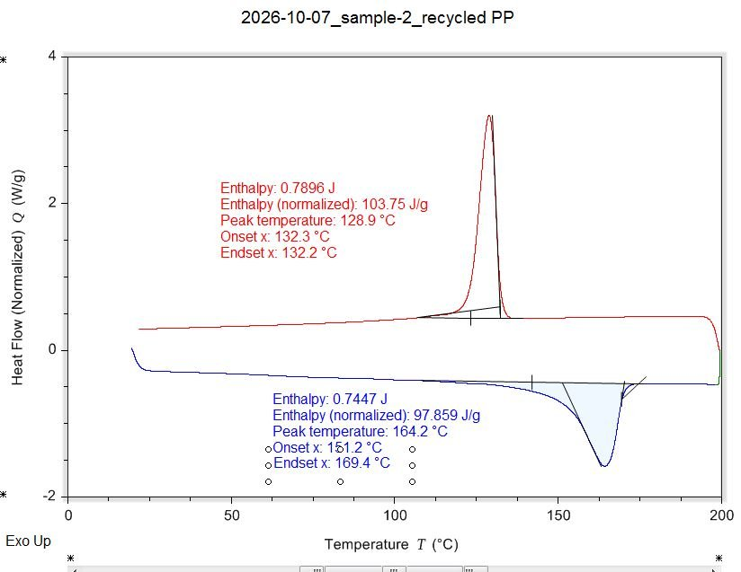
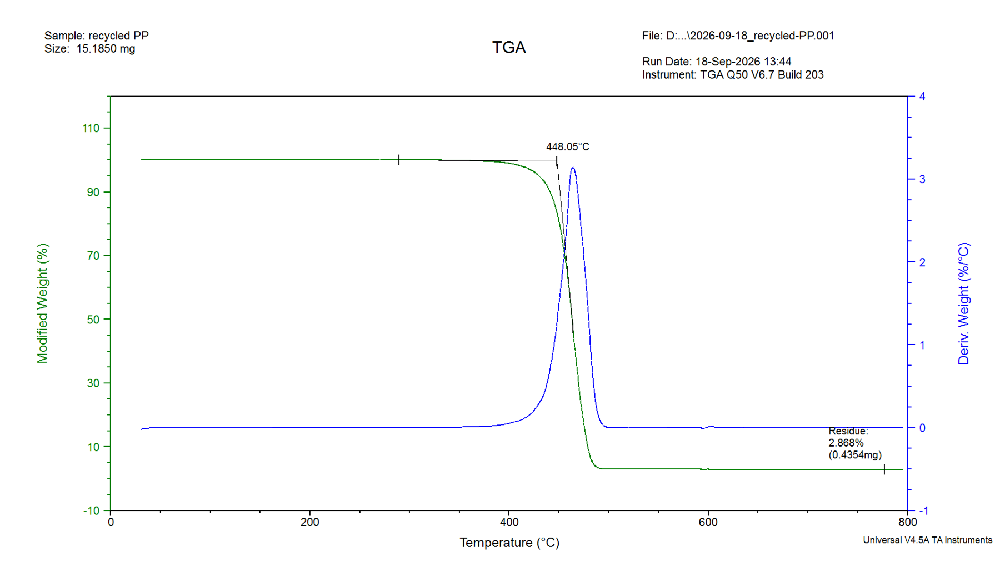
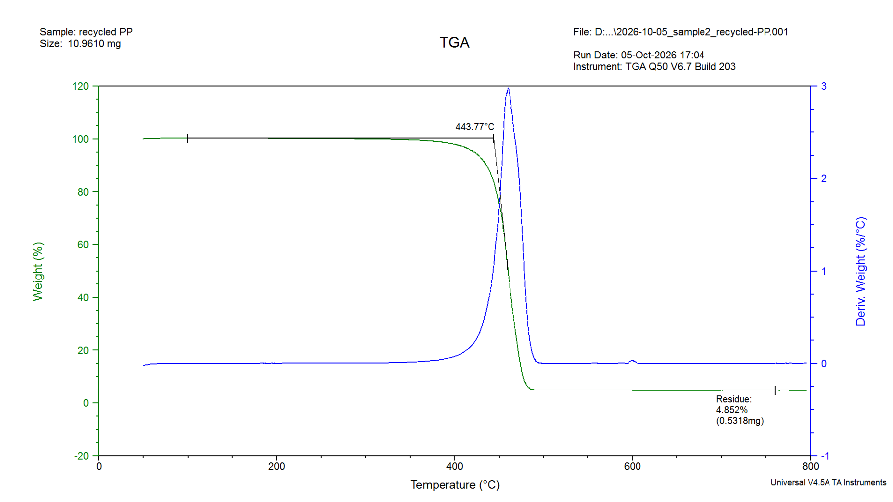
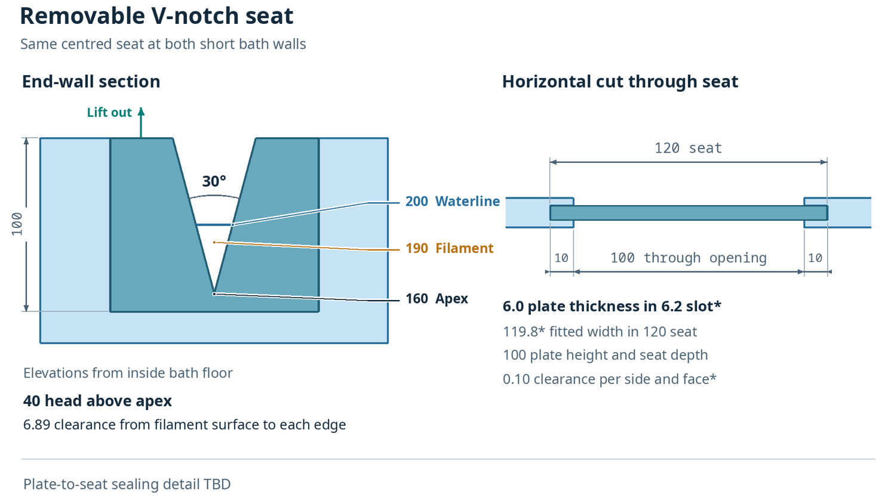
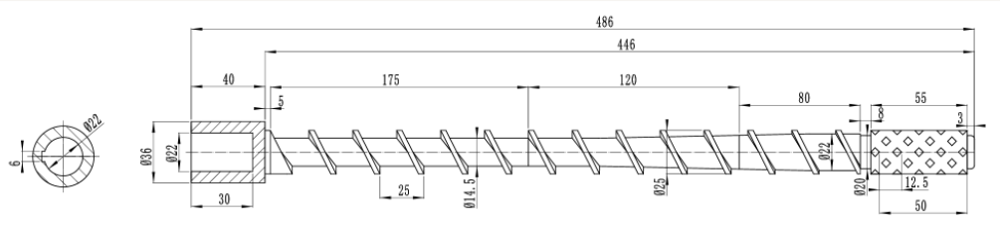
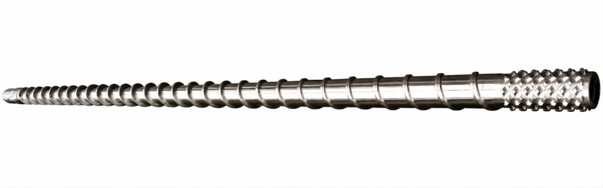

## Appendix A: Calculation of PP5 waste generated in NUS {#appendix-a}

Preliminary figures from NUS SSU indicated that an average laboratory disposes of roughly 20 pipette tip boxes per week [8]. Assuming approximately 300 laboratories across the institution and a weight of 107 grams (0.107kg) per PP pipette box, the total amount of PP discarded can be calculated as follows:

#### PP waste produced per Lab per Week

**Total Mass**

$$M_{lab,week} = 0.107 \times 20 = 2.14\ \text{kg}$$

#### PP waste produced across all Labs per Week

**Total Mass**

$$M_{week} = 2.14 \times 300 = 642\ \text{kg}$$

#### (Estimated) PP waste produced per Year (52 weeks) on Campus

**Total Mass**

$$M_{year} = 642 \times 52 = 33{,}384\ \text{kg}$$

## Appendix B: Calculation of Cost of 3DP Filament Spools {#appendix-b}

As per the information presented on the quantity of spools used by the different target end users in Table 1.01, we can calculate and estimate the upper and lower limits costs for acquiring 3D Printing Filament.

For the lower limit, a 3DP Spool price of S$22 is used, while a 3DP Spool price of S$25 is used for upper limit calculations

#### Cost of 3DP Spools – Robomasters

**Lower Limit**

$$C_{lower,Robo} = \text{S}\$22 \times 200 = \text{S}\$4{,}400$$

**Upper Limit**

$$C_{upper,Robo} = \text{S}\$25 \times 200 = \text{S}\$5{,}000$$

#### Cost of 3DP Spools – Dept. of Architecture (DoA)

For the DoA, the lower limit is calculated with the assumption that every student in a batch of approximately 650 uses 1 spool of 3DP Filament, while the upper limit is calculated with the assumption that every student uses 5 such spools

**Lower Limit**

$$C_{lower,DoA} = \text{S}\$22 \times 650 = \text{S}\$14{,}300$$

**Upper Limit**

$$C_{upper,DoA} = \text{S}\$25 \times 3250 = \text{S}\$81{,}250$$

#### Cost of 3DP Spools – Innovation & Design Hub

**Lower Limit**

$$C_{lower,IDHub} = \text{S}\$22 \times 70 = \text{S}\$1{,}540$$

**Upper Limit**

$$C_{upper,IDHub} = \text{S}\$25 \times 70 = \text{S}\$1{,}750$$

#### Overall Upper and Lower limit cost

**Lower Limit**

$$C_{Total} = 4{,}400 + 14{,}300 + 1{,}540 = \text{S}\$20{,}240$$

**Upper Limit**

$$C_{Total} = 5{,}000 + 81{,}250 + 1{,}750 = \text{S}\$88{,}000$$

## Appendix C: Inquiry with Semula Asia {#appendix-c}

Below shows the email transcript between our project team and Semula Asia, with sensitive information removed

* * *
Dear Semula,

I hope this email finds you well!

We are a group of students from the National University of Singapore (NUS) working on a sustainability project that aims to recycle polypropylene (PP5) plastic waste into 3D printing filament.

As part of our project, we have been sending our collected PP5 plastic waste to your company for shredding before using the resulting flakes as feedstock for our polymer extrusion prototype.

We would like to better understand your shredding process, particularly regarding the possibility of contamination by other materials. Specifically, we would appreciate your clarification on the following:

1.  Shredding process: Are our PP5 plastics shredded separately from other plastic types, or is the same equipment used to process different materials?
2.  Cross-contamination: If the same equipment is used, is there a possibility of residual plastics, such as PET, PA or PLA, being mixed into our PP5 flakes? Are there any cleaning procedures between batches to minimise this?
3.  Labels and stickers: How are contaminants such as paper labels, adhesive stickers or other cellulose-based materials handled during shredding? Are these removed beforehand, or could they remain in the shredded flakes?

As the purity of our PP5 feedstock is important for achieving consistent filament quality during extrusion, understanding these potential sources of contamination would be very helpful for our project.

Thank you for your time and assistance! We look forward to hearing from you.

* * *
Hi,

Thank you for the information. Yes, we helped to shred once and the amount was less than 3 kg. Here's my response to your questions:

1.  Shredding process: Are our PP5 plastics shredded separately from other plastic types, or is the same equipment used to process different materials? We only have 1 shredder for coloured plastic and we work mainly with HDPE.
2.  Cross-contamination: If the same equipment is used, is there a possibility of residual plastics, such as PET, PA or PLA, being mixed into our PP5 flakes? Are there any cleaning procedures between batches to minimise this?  When Yi Ning sent the PP plastic to us, we vacuumed the shredder before shredding her plastic. There is potentially small quantities of HDPE residues remaining in the shredder after vacuum.
3.  Labels and stickers: How are contaminants such as paper labels, adhesive stickers or other cellulose-based materials handled during shredding? Are these removed beforehand, or could they remain in the shredded flakes? We remove all labels and stickers before shredding.

## Appendix D: FTIR Methodology, Relevant Data and Experimental Results {#appendix-d}

### FTIR Methodology

Instrument: PerkinElmer Spectrum Two FTIR spectrometer with a universal ATR accessory and diamond top plate.

### Preparation and measurement

1. Switch on the computer and confirm that the spectrometer’s front-right indicator is green. Open Spectrum IR, select Analyst and connect to the instrument if prompted.
2. Clean the diamond crystal using a cotton swab and ethanol. Select the appropriate clamp tip. The lab sheet specifies the medium tip for higher pressure and the large tip for lower pressure.
3. Under Navigation → Setup → Instrument, set up the acquisition. Enter a unique sample ID and choose your own save folder. The sample ID becomes the file name. Enable Save after each measurement and set an export folder if automatic export is needed.
4. With the diamond clean and empty, select Background. Click Scan to bring up the preview, then click Scan again to acquire the background.
5. Select Sample and choose absorbance or percentage transmittance. Place the flake or filament specimen on the crystal, using a flat face where available. Bring the clamp into contact with the specimen.
6. Click Scan to preview the spectrum and force gauge. Adjust the clamp pressure until the bands are clearly resolved. The sheet gives a target of roughly 40–80% transmittance, equivalent to 0.1–0.4 absorbance. Reduce the pressure if the force gauge turns red. Click Scan again to acquire the spectrum.
7. Release the clamp, remove the specimen and clean the crystal immediately with a cotton swab and ethanol. Repeat for each specimen. Keep the acquisition settings consistent when comparing spectra.

*Table D.01: Settings for FTIR machine*
{: .caption}

| Setting | Lab-sheet guidance |
|---|---|
| Accumulation | At least 4 scans |
| Spectral resolution | Typically 4 cm⁻¹ |
| Wavenumber range | 4000–450 cm⁻¹ as the SOP default. The project PDF describes approximately 4000–400 cm⁻¹. Confirm the lower limit from the original spectrum files before reporting it as exact. |
| Atmospheric correction | CO₂/H₂O correction recommended |
| Advanced settings | AVI and Look Ahead off. Scan speed 0.2 cm/s, magnitude phase correction, strong apodisation and zero start delay. |

### After testing

Clean the crystal and clamp tip, replace the ATR top-plate cover, clean the workstation and record usage in the log sheet. Save the spectra in your folder, close Spectrum IR and switch off the computer as directed. Scan any USB drive before connecting it. The crossed-out accessory changeover steps are omitted for this diamond-ATR setup.

*Table D.02: Reference ATR-FTIR bands for PP5 and potential contaminants*
{: .caption}

| Material | Functional group or Structural feature | Expected ATR-FTIR bands and assignments (cm⁻¹) | Interpretation in PP5 |
|---|---|---|---|
| Polypropylene (PP, reference matrix) | Aliphatic methyl (–CH₃) and methylene (–CH₂–) groups | ≈2950, 2915 and 2838 for C–H stretching. ≈1455 and 1375 for C–H bending. ≈1167, 997 and 973 for coupled methyl rocking and backbone vibrations. | The fingerprint near 1167, 997 and 973 supports PP identification. |
| High-density polyethylene (HDPE) | Predominantly linear methylene chains | ≈2915 and 2845–2850 for CH₂ stretching. ≈1472 and 1462 for CH₂ bending. ≈730 and 717–720 for CH₂ rocking. | The rocking bands can support a PE assignment when they occur with the other PE bands. They are shared by multiple PE grades. |
| Low-density polyethylene (LDPE) | Methylene backbone with more chain branching | ≈2915 and 2845–2850 for CH₂ stretching. ≈1460–1470 for CH₂ bending. ≈730 and 717–720 for CH₂ rocking. A branch-related methyl band may appear near 1377. | The methyl band can help distinguish LDPE in a PE-rich sample. In PP5, it overlaps the PP methyl band near 1375. |
| Linear low-density polyethylene (LLDPE) | Methylene backbone with short-chain branches | ≈2915 and 2845–2850 for CH₂ stretching. ≈1460–1470 for CH₂ bending. ≈730 and 717–720 for CH₂ rocking. A methyl contribution may appear near 1377. | The bands strongly overlap those of LDPE and HDPE. The PE family is easier to identify than the specific grade. |
| Polyethylene terephthalate (PET) | Aromatic ester | ≈1713–1720 for ester C=O stretching. ≈1240 and 1095 for ester C–O stretching. ≈872 and 720 for aromatic C–H out-of-plane bending. | The carbonyl and ester C–O bands together are more informative than the band near 720, which overlaps PE. |
| Polylactic acid (PLA) | Aliphatic ester | ≈1750 for ester C=O stretching. ≈1183 and 1085 for ester C–O vibrations. | The carbonyl and accompanying ester bands support a PLA assignment. |
| Polystyrene (PS) | Aromatic phenyl rings | ≈3024 for aromatic C–H stretching. ≈1601 and 1492 for ring stretching. ≈694–700 for aromatic C–H out-of-plane bending. | The aromatic band pattern distinguishes PS from the PP matrix. |
| Polyamide 6 (PA6, nylon 6) | Amide linkages (–CONH–) | ≈3300 for N–H stretching. ≈1630–1640 for amide I, mainly C=O stretching. ≈1540–1545 for amide II, mainly N–H bending and C–N stretching. | The amide I and II pair supports the presence of a polyamide. |
| Polyamide 66 (PA66, nylon 6,6) | Amide linkages (–CONH–) | ≈3300 for N–H stretching, ≈1634 for amide I and ≈1538–1545 for amide II. | The principal amide bands overlap those of PA6. |
| Cellulose (paper or label fibres) | Hydrogen-bonded hydroxyl groups and glycosidic linkages | Broad ≈3200–3600 O–H stretching band. ≈1160 for glycosidic C–O–C stretching. ≈1025–1050 for C–O stretching and ≈897 for a glycosidic fingerprint band. Absorbed water can contribute near 1630–1650. | The broad O–H band is most informative when it appears alongside the carbohydrate fingerprint bands. |

*Figure D.01: FTIR data from PCW-PP (Run 1)*
{: .caption}

*Figure D.02: FTIR data from PCW-PP (Run 2)*
{: .caption}

## Appendix E: DSC Methodology, Relevant Data and Experimental Results {#appendix-e}

### DSC Methodology

Instrument: TA Instruments DSC 25 with RCS 90 cooling and TRIOS software. Use the Shimadzu AP125WD analytical balance for sample preparation.

### Instrument preparation and optional cell conditioning

1. Open the nitrogen supply and the DSC line as instructed in the lab. Verify a base purge of at least 300 mL/min and a cell purge of 50 mL/min. Clean the stainless-steel tray, tweezers and spatula. Apply the correct cell-constant and temperature calibrations and photograph the empty DSC cell.
2. If conditioning is required, go to Calibration → Calibration Setup in TRIOS. Select Cell Conditioning, clear the other calibration selections and queue the run. Keep the conditioning temperature at 75 °C. The sheet suggests a 15-minute hold if the DSC was last used one day ago, 30 minutes after a few days, and 60 minutes or longer after more than a week.
3. For conditioning only, temporarily clear Wait for cooler readiness before each run under Instrument → Options → Cooler. Start the conditioning run and wait for it to finish. TRIOS then activates the RCS 90. Once the cooler is ready, re-enable the readiness setting before starting any sample run. If conditioning is skipped, switch on the RCS 90 manually in TRIOS.

### Sample preparation and measurement

1. Wake the analytical balance, confirm the required status icon is present and run internal calibration. Select the appropriate range and units. The weighing sheet lists 0.1 mg readability up to 120 g and 0.01 mg readability up to 52 g. If the balance shows an overload with an empty pan or the status icon is absent, check with the lab technician.
2. Put a clean weighing boat on the balance. Place the empty DSC pan in the appropriate bottom die and set both on the boat. Close the glass doors, wait for the stability indicator and tare. Add the specimen, close the door again and wait for a stable reading. Record the net specimen mass. Remove all items from the balance and return it to standby when finished.
3. Place the lid on the pan, crimp it using the Tzero press and the die set for the selected pan, and clean the die after use. The lab notice gives the following empty pan-plus-lid masses, which are separate from the specimen mass.
    - Standard Al: 20 - 22 mg
    - Hermetic Al: 50 - 51 mg
    - Tzero Al: 51 - 53 mg
    - Tzero hermetic aluminium: 53 - 54 mg

4. Create the run in TRIOS. Enter the operator, specimen ID, net sample mass and pan type, then load the sample pan and reference pan. The project PDF specifies a nitrogen heat–cool–heat cycle from 20 → 200 → 20 → 200 °C at 10 °C/min.
5. Before starting, verify that the correct calibrations are active, the RCS 90 is ready, the flange temperature is −70 °C or colder, and Wait for cooler readiness before each run is enabled. Start the run and let the programme finish.

### Precautions and closeout

The posted lab rule requires the maximum DSC temperature to be at least 50 °C below the specimen’s decomposition temperature. Use TGA first if the decomposition temperature is uncertain. Flag samples containing LiCl or other potentially corrosive substances to the lab technician. After the run, remove the sample and reference pans, collect the sample pan for disposal, photograph the empty cell, switch off the RCS 90 in TRIOS and log the session. Leave the gas cylinders for lab staff to close. Scan any USB drive before use.

*Table E.01: Reference DSC transitions for PP5 and potential contaminants*
{: .caption}

| Material | Approximate Tg (°C) | Approximate Tm (°C) | Expected feature in the 20–200 °C scan |
|---|---|---|---|
| PP | −10 | 155–170 for common isotactic PP grades. Some PP copolymers melt lower. | PP melting falls within the scan. Its Tg is below the starting temperature. |
| HDPE | Around −120 | 120–137 | A separate melting endotherm may be resolved below the main PP peak. |
| LDPE | Around −120 | 105–115 | A lower-temperature melting endotherm may be resolved. |
| LLDPE | Around −120 to −110 in reported examples | 90–130, grade-dependent | Its melting region overlaps those of LDPE and HDPE. Peak temperature alone gives limited grade discrimination. |
| PET | 70–80 | 245–265 | A Tg step may be visible. The melting peak lies above 200 °C. |
| PLA | 55–65 | 150–180 for common semicrystalline grades | A Tg step and, depending on thermal history, a cold-crystallisation event may be visible. PLA melting can overlap the main PP peak. |
| PS, common amorphous grade | Around 95–105 | No crystalline melting peak | A baseline step near 100 °C is the expected transition. |
| PA6 | Around 40–60 when dry | 220–226 in representative grades | A Tg step may be visible and can shift with moisture. The melting peak lies above 200 °C. |
| PA66 | Around 63 in a representative grade, moisture-dependent | Around 260–265 | A Tg step may be visible. The melting peak lies above 200 °C. |
| Cellulose (paper or label fibres) | No single diagnostic Tg for paper residue in this scan | No characteristic melting peak in this scan | Moisture loss may produce a broad endotherm. A paper residue can also contain coatings or adhesives that contribute their own transitions. |

*Figure E.01: DSC curve of PCW-PP (Run 1). Blue curve indicates the melting stage where the additional melting peaks were being looked out for*
{: .caption}

*Figure E.02: DSC curve of PCW-PP (Run 2). Blue curve indicates the melting stage where the additional melting peaks were being looked out for*
{: .caption}

## Appendix F: TGA Methodology and Experimental Results {#appendix-f}

### TGA Methodology

Instruments: TA Instruments Q50 for PCW-PP and 40T, and TA Instruments Q500 for virgin PP and EPP, as recorded in the project PDF.

### Preparation and measurement

1. Confirm that the sample is suitable for high-temperature testing. The lab restricts materials that can release corrosive gases. For uncertain compositions, give the lab technician the available composition or safety data for review before heating.
2. Open the nitrogen supply and, for an oxidative stage using air, the purified or compressed air supply as instructed. Open the fume extractor arm shutters. Clean the stainless-steel tray, tweezers and spatula. Photograph the thermocouple and hang-down wire before use.
3. Check the alumina crucible and clean it if necessary. If the hang-pan is dirty, ask the lab technician to clean it. Take care around the hang-down wire, which can be bent or damaged during handling.
4. Set up the test method. The lab sheet specifies 40 mL/min balance purge and 60 mL/min sample purge as standard settings. Select the appropriate sample gas for each stage. Set Post Test → Furnace: Closed and leave air cooling disabled. The lab caps the heating rate at 50 °C/min and the maximum temperature at 800 °C.
5. Place the clean, empty crucible on the hang-pan and select Tare. Wait for taring to finish before loading the specimen. The lab recommends 10–20 mg, with a fill limit of 80% of crucible volume, even if the specimen weighs less than 10 mg. Return the loaded crucible to the hang-pan.
6. Start the run and leave the requested message on the TGA computer. The project PDF specifies heating under nitrogen to 600 °C, followed by an oxidative stage to 800 °C. Confirm the actual heating rate, any holds and the gas used for the oxidative stage from the instrument method files.

### Precautions and closeout

The lab sheet prohibits unloading while the furnace is 500 °C or hotter. Follow the lab’s unloading procedure and handle the crucible with the designated tools once the instrument is ready. Dispose of the residue as directed, retain any hazardous material for proper disposal and clean the crucible. Photograph the thermocouple and hang-down wire again, close the furnace and close the extractor shutters at the end of the session. Leave the gas cylinders, TGA and computer on as instructed. Log the session, record actual usage in PPMS and scan any USB drive before use.

*Figure F.01: TGA curve of PCW-PP (Run 1) Green curve shows change in sample weight over time, while Blue curve shows rate of change of sample weight over time*
{: .caption}

*Figure F.02: TGA curve of PCW-PP (Run 2) Green curve shows change in sample weight over time, while Blue curve shows rate of change of sample weight over time*
{: .caption}

## Appendix G: Relevant Data for Water Baths {#appendix-g}

The single-zone prototype has proposed internal dimensions of 40 cm × 25 cm × 25 cm, measured as length × width × height. The operating water depth is set by the notch apex elevation and the overflow head. The width and height provide room for the strand, return diffuser and clearance above the waterline.

The tank will use 0.5-inch (12.7 mm) thickness acrylic sheet. The team has identified a supplier offering custom acrylic fabrication. Plexiglas’s reported thermal conductivity of 0.19 W/(m·K) and specific heat capacity of 1.47 kJ/(kg·K) and density of 1,190 kg/m³ give it low thermal conductivity properties that help limit heat transfer through the dividers between temperature zones.

A representative glass transition temperature for Plexiglas (PMMA) is 105 °C [48]. Röhm lists maximum permanent service temperatures of 80 °C for the specified GS grades and 70 °C for the specified XT grades. Both ratings are above the proposed maximum bath setpoint of 60 °C. The supplier’s datasheet for the selected sheet grade should be recorded with the fabrication specification [49].

Each short end wall will have a centred 10 cm-wide × 10 cm-high opening extending down from the top edge. A 1 cm recess on either side widens the seat to 12 cm, with a nominal slot thickness of 6 mm. This stepped opening accepts a removable printed V-notch plate approximately 12 cm wide × 10 cm high × 6 mm thick. The fabricated slot and printed plate should be checked together for fit and leakage around the edges. Figure G.01 below shows a clearer diagram of the V-Notch assembly.

*Figure G.01: Diagram showing Dimensions of the removable V-Notch Weirs and the recessed seat in the Plexiglas for the Weirs to be inserted into*
{: .caption}

At steady state, assuming negligible leakage and water carried out by the filament, the single-zone pump return equals the combined overflow through the two notches (Eqn G1). The Bernoulli-based sharp-crested weir equation (Eqn G2) estimates the discharge through each notch [50, 51].

$$Q_{pump} = Q_{notch1} + Q_{notch2} \approx 2Q_{notch}$$
*(Eqn G1)*
{: .eqn-label}
$$Q = \frac{8}{15} C_d \sqrt{2g}\, \tan\left(\frac{\theta}{2}\right) H^{2.5} \approx 1.417 \tan\left(\frac{\theta}{2}\right) H^{2.5}$$
*(Eqn G2)*
{: .eqn-label}
Here, Q is the discharge through the V-notch in m³/s, θ is the angle of the V-notch, H is the height of the water surface above the apex of the triangular notch, $$C_d$$ is its discharge coefficient which has a value ranging from 0.58 - 0.62 and g is the Gravitational acceleration which has a value of 9.81m/s².

For $$C_d$$, 0.60 is tentatively used as an assumed coefficient for preliminary sizing, to be checked against measured discharge.

## Appendix H: Estimated Budget for Water Baths {#appendix-h}

*Table H.01: Estimated Budget for 40cm Single-zone Water Bath*
{: .caption}

| Item | Qty | Unit cost (S$) | Estimated subtotal (S$) |
|---|---|---|---|
| Custom acrylic bath with two V-notches | 1 | 120–280 | 120–280 |
| Custom acrylic overflow collectors | 2 | 40–110 | 80–220 |
| SUNSUN HQJ-1000B pumps | 2 | 23 | 46 |
| AQUAPRO 16/22 mm return hose, 3 m roll | 2 rolls | 13 | 26 |
| Silicone gravity-drain hose | 3 m | 7/m | 21 |
| Thin-wall bulkhead fittings | 2 | 6–15 | 12–30 |
| 20 mm T-connector | 1 | 2 | 2 |
| Straight reducers | 2 | 2–3 | 4–6 |
| Clamps, adaptors and sealing consumables | 1 lot | 10–25 | 10–25 |
| Flow-control valves | 2 | 3–6 | 6–12 |
| IKEA SAMLA 22 L shared sump | 1 | 6.90 | 6.90 |
| Total estimated budget |  |  | 333.90–674.90 |

*Table H.02: Estimated budget for the 1.20 m three-zone water bath*
{: .caption}

| Item | Qty | Unit cost (S$) | Estimated subtotal (S$) |
|---|---|---|---|
| Custom acrylic tank, including two dividers and weir seats | 1 | 510–850 | 510–850 |
| Custom acrylic end sumps | 2 | 55–150 | 110–300 |
| Hot-water circulation pump and power supply | 1 set | 70–150 | 70–150 |
| Room-temperature inline pump | 1 | 48–80 | 48–80 |
| Room-temperature loop hose, 3 m roll | 1 roll | 13 | 13 |
| Temperature-rated silicone hose for the hot loop | 3 m | 7–20/m | 21–60 |
| Thin-wall bulkhead fittings | 2 | 6–15 | 12–30 |
| Flow-control valves | 2 | 3–6 | 6–12 |
| Reducers, clamps, adaptors and seals | 1 lot | 14–31 | 14–31 |
| Return diffusers | 2 | 5–15 | 10–30 |
| Removable printed V-notch inserts | 2 | 5–15 | 10–30 |
| Latex divider membranes and mounting hardware | 1 lot | 5–15 | 5–15 |
| Water immersion heater elements | 2 | 45–85 | 90–170 |
| PID controller, relay and temperature probe | 2 sets | 50–100 | 100–200 |
| Control enclosure and heater mounting hardware | 1 lot | 40–100 | 40–100 |
| Bath support frame and sump supports | 1 lot | 60–180 | 60–180 |
| Total estimated budget |  |  | 1,119–2,251 |

## Appendix I: Computation of data from experimental runs {#appendix-i}

The diameter measurements collected from each experimental run were used to calculate the following metrics:

- Average diameter: The horizontal & vertical measurements were averaged to obtain a single diameter value at each measurement point.

$$D_i = \frac{D_{H,i} + D_{V,i}}{2}$$

At each measurement point : Di is the average diameter (mm), DH,i is the horizontal diameter (mm) and DV,i is the vertical diameter (mm)

- Sample mean diameter: The average diameter values obtained at all the measurement points were summed and divided by the total number of measurement points for each sample.
- Standard deviation of diameter: Calculated using the standard deviation formula

$$s = \sqrt{\frac{\sum_{i=1}^{n}\left(D_i - \bar{D}\right)^2}{n-1}}$$

$$\bar{D}$$ is the sample mean diameter (mm),  n is the total number of measurement points and s is the sample standard deviation (mm)

- Percentage of filament within the acceptable diameter range: The number of measurement points with diameters between 1.70 mm and 1.80 mm was divided by the total number of measurement points and multiplied by 100%.
- Minimum diameter: Smallest average diameter recorded across all the measurement points
- Maximum diameter: Largest average diameter recorded across all the measurement points

## Appendix J: Relationship Between Volumetric Flow Rate and Melt Velocity {#appendix-j}

Based on the principle of conservation of mass, the continuity equation relates volumetric flow rate to cross-sectional area and average fluid velocity for incompressible flow (constant density). At the extrusion die exit, this relationship can be expressed as:

$$Q = A\bar{V}$$

Q is the volumetric flow rate at the die exit (m³/s), A is the cross-sectional area of the extrusion die (m²) and $$\bar{V}$$ is the average melt velocity at the die exit (m/s)

Since the die has a fixed cross-sectional area, $$A$$ remains constant. Therefore, considering changes over time:

$$Q(t) = A\bar{V}(t)$$

At two different instants (t1 and t2):

$$Q_1 = A\bar{V}_1$$

$$Q_2 = A\bar{V}_2$$

Therefore,

$$\Delta Q = A\,\Delta\bar{V}$$

## Appendix K: Design & Fabrication of single-screw extruder with pineapple mixing section {#appendix-k}

#### CAD drawing of single-screw extruder with pineapple mixing section

#### Photograph of single-screw extruder with pineapple mixing section

*Table K.01: Estimated budget for the single-screw extruder with pineapple mixing section*
{: .caption}

| Item | Qty | Unit cost (S$) | Estimated subtotal (S$) |
|---|---|---|---|
| Single-screw extruder with pineapple mixing section | 1 | 245 | 245 |

## Appendix L: Characteristic heat conduction distance and thermal diffusion time {#appendix-l}

The characteristic time required for heat to diffuse through a material depends on the distance over which heat is transferred and the material's thermal diffusivity. This relationship can be approximated as:

$$t_{\text{diff}} \approx \frac{L^2}{\alpha}$$

tdiff  is the characteristic thermal diffusion time (s), L is the characteristic heat conduction distance (m) and $$\alpha$$ is the thermal diffusivity of PP melt (m²/s)

Assuming approximately constant thermal diffusivity ($$\alpha$$ ) within the PP melt, the characteristic thermal diffusion time is proportional to the square of the heat conduction distance. Hence, a shorter conduction distance reduces the time required for heat to diffuse between hotter and cooler regions of the melt, helping to enhance the thermal mixing during extrusion.
