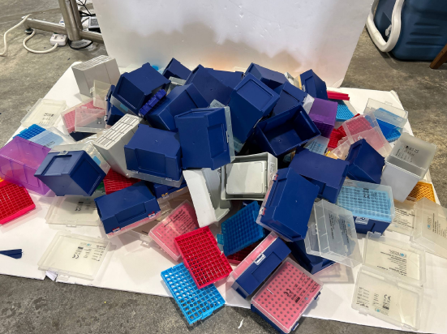
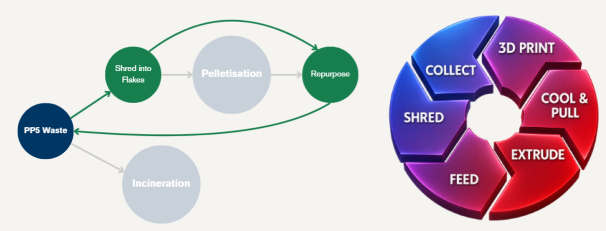

## 1.1 Background and Motivation {#s1-1}

The National University of Singapore (NUS) generates a steady stream of polypropylene (PP/PP5) waste, including discarded laboratory pipette-tip boxes. A preliminary campus-wide extrapolation suggests that pipette-tip boxes alone could account for approximately 33 tonnes of discarded PP5 per year (Appendix A for calculations), with incineration identified as the disposal route for the waste stream. This project investigates how suitable PP can be recovered and converted into filament for campus prototyping and design.

*Figure 1.01: Sample of NUS PP waste consisting of lab pipette boxes*
{: .caption}

This campus-scale effort addresses part of Singapore’s broader plastic waste challenge. In 2025, Singapore generated 890,000 tonnes of plastic waste across all plastic types. 34,000 tonnes, or approximately 3.8%, were recorded as recycled, and 856,000 tonnes were disposed of [1] and incinerated at waste-to-energy plants [2] and the resultant ash was disposed of at Semakau Landfill [1]. Although incineration recovers energy, it consumes the polymer. Recovering suitable PP before disposal keeps the material in use as a manufacturing feedstock.

Conventional mechanical recycling of Post-Consumer Waste PP (PCW-PP) involves shredding the waste and melting-extruding it into pellets for subsequent manufacturing [3]. Geier et al. (2024) found that PCW-PP moulded directly from flakes had a slightly lower melt flow rate and higher low-shear viscosity than PP that underwent melt filtration and pelletisation first. They linked these differences to reduced thermomechanical stress [4]. Langwieser et al. (2022) also noted progressive decrease in PP molecular weight over repeated processing cycles, consistent with polymer chain scission [5]. As degradation accumulates, the material falls outside processing or performance requirements after fewer recycling cycles. EcoSpool investigates direct extrusion of shredded PP5 into filament to eliminate intermediate melt pass and reduce heat and shear exposure.

## 1.2 Local Circular Economy Model and Potential Value {#s1-2}

*Figure 1.02: Simplified, proposed Closed-loop for PP recycling bypassing the Pelletisation stage*
{: .caption}

The proposed loop segregates PP5 waste for shredding and extruding directly into filament for campus use. Section 2.2.1 describes the preparation of the batch tested. At 1 kg per spool, the inherited demand estimate represents 0.92–3.52 tonnes annually, or about 3–11% of the 33 tonne estimate. EcoSpool therefore targets a portion of the campus waste stream.

Potential campus users include the NUS RoboMaster team, the Department of Architecture and the Innovation & Design Hub. Preliminary estimates place their combined spending on filament spools between S$20,240–S$88,000 annually . EcoSpool could offset some of these purchases where its recovered filament meets users’ requirements. Other universities and organisations with segregated PP waste and fabrication demand could adapt similar models, creating multiple closed loops for widespread sustainable usage and end-of-life processing of PP waste.

*Table 1.01: Estimated spool consumption and spending across aforementioned targeted end users (See Appendix B for calculations)*
{: .caption}

| Group | Spool consumption/yr | Est. Annual spend/S$ (~ S$22 - 25/spool) |
|---|---|---|
| Robomasters | 200 | 4,400 - 5,000 |
| Architecture | 650 - 3250 | 14,300 - 81,250 |
| Innovation & Design Hub | 70 | 1,540 - 1,750 |
| Total | 920 - 3520 per year | S$20,240 - S$88,000 |

The interim Q&A gave an indicative line and upgrade cost of S$3,000–4,000. Appendix H lists earlier bath allowances of S$1,453–2,926 combined. At 173 g/h and 2,000 h/year, one line could make 346 1kg spools before losses. At S$22–25 per displaced spool, gross payback would be about 4 - 6 months at full replacement, or 1.4 - 2.1 years at 25% replacement. These scenarios exclude operating costs. Continuous operation would yield about 1.5 tonnes annually, equivalent to roughly 22 lines for 33 tonnes.

A commercial comparison is the €1,399 (S$1,992) Felfil Evo and Spooler+ bundle [53]. Felfil reports 100 - 150 g/h and ±0.07 mm for the Evo, which accepts pellets and prepared shredded feedstock [54].

## 1.3 Current Project Objectives and Scope {#s1-3}

This phase establishes the baseline for feeding, extrusion and cooling. The inherited ±0.10 mm band is the commissioning milestone [8]. The ±0.05 mm Verbatim benchmark is the stretch target [6]. A 1 kg net spool is a common purchase unit [7], equivalent to about 460 m of PP filament at 1.75 mm [6] and about six hours at nominal output.

*Table 1.02: Proposed commissioning and final validation criteria.*
{: .caption}

| Requirement | Proposed criterion | Verification |
|---|---|---|
| Diameter | 1.65–1.85 mm for commissioning [8]. 1.70–1.80 mm stretch target [6]. | Log both axes along the spool. Report mean, spread and fraction in each band. |
| Ovality | ≤0.08 mm, inherited benchmark [8]. | Absolute difference between orthogonal diameter readings. |
| Straightness | Zero guide departures in the final trial. Median lateral offset at least 30% below the air baseline. | Film the guide path. Measure offset on relaxed 1 m samples. |
| Spool mass and repeatability | Two successive 1.00 kg net spools as the proposed final check. | Tare the reel and record accepted filament mass for each run. |
| Printability | Complete one 3DBenchy from each spool with no jam or print interruption. | Use a PP-compatible build surface and log printer settings [6]. |

## 1.4 Problem Statement {#s1-4}

“How can EcoSpool consistently produce usable 1 kg spools of filament from PCW-PP flakes, with a nominal diameter of 1.75 mm and in compliance with the dimensional and handling criteria?”
