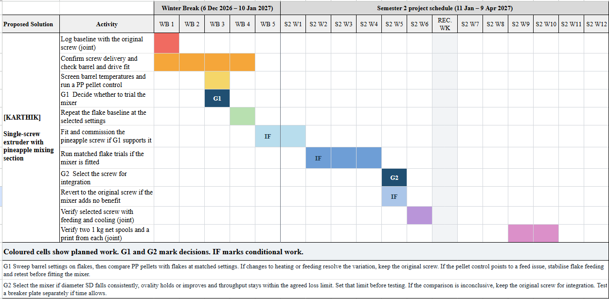

## 5.1 Next-Semester Work Plan and Timeline {#s5-1}

*Figure 5.01: Timeline of modifying & prototyping extrusion set-up*
{: .caption}

The proposed timeline for the development, testing, and evaluation of the three solutions is presented in Figure 5.01, and the corresponding activities and expected completion dates are summarised in Table 5.01.

*Table 5.01: Planned Activities and Key Milestones for the Next Semester*
{: .caption}

| Timeline | Planned activities |
|---|---|
| By late Dec | Record baseline mass output, actual pull speed and flake top-ups. Using the original screw, run three matched comparisons of aligned air cooling and room-temperature still water in the 40 cm bath. Advance water cooling if median lateral offset falls by at least 30% and diameter variation and ovality stay the same or improve. If water cooling advances, inspect cross-sections for recurring internal voids to decide whether a three-zone trial is warranted. In separate runs with the original screw, conduct a barrel-temperature sweep and a PP pellet control. Use the results to decide whether to trial the pineapple screw. |
| By mid-Jan | Confirm screw delivery and check compatibility with the barrel and drive. Repeat the flake baseline at the selected settings. Fit and commission the pineapple screw if diameter variation persists with stable feeding. |
| By mid-Feb | If the pineapple screw is fitted, complete three matched flake runs per screw and compare diameter variation, mean diameter, ovality, percentage within 1.70–1.80 mm and mass output. Select the screw for integration based on whether it consistently reduces diameter variation while maintaining ovality and meeting the agreed throughput limit. Build a recirculation loop if water level or temperature requires tighter control. Bench-test the seals and assemble the three-zone bath if recurring voids warrant a staged cooling trial. |
| By late Feb | Verify cooling performance with the selected screw after the individual trials. |
| By mid-Mar | If the three-zone trial proceeds, compare single-zone and three-zone cooling at equal immersed lengths. Assess internal voids, ovality and straightness. Select the cooling setup and, if using water, verify drying before winding. |
| By late Mar | Validate the integrated setup by producing two successive spools, each containing 1 kg of filament. Check filament dimensions and print one 3DBenchy from each spool. |
| By early Apr | Consolidate the findings from the cooling and screw trials and finalise the project report. |
