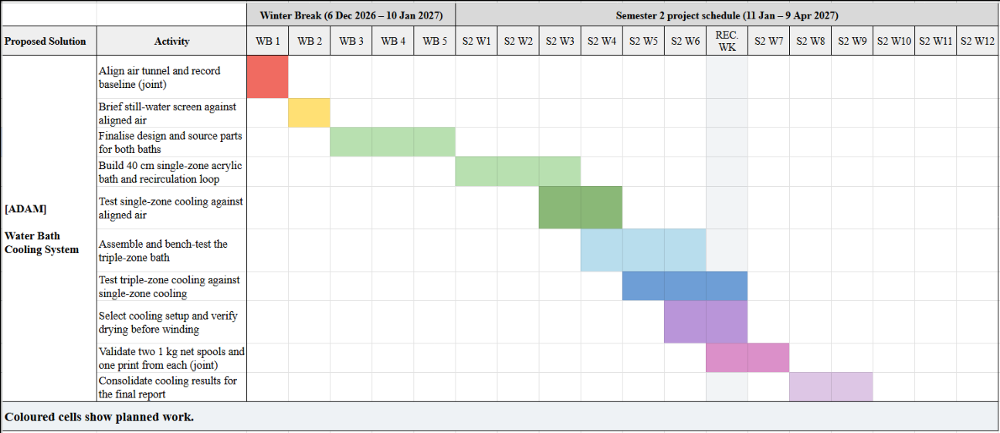

## 5.1 Next-Semester Work Plan and Timeline {#s5-1}

*Figure 5.01: Forecast timeline for modifications and prototyping*
{: .caption}

The proposed timeline for the development, testing, and evaluation of the three solutions is presented in Figure 5.01, and the corresponding activities and expected completion dates are summarised in Table 5.01.

*Table 5.01: Planned Activities and Key Milestones for the Next Semester*
{: .caption}

| Timeline | Planned activities |
|---|---|
| By late Dec | Align the air tunnel and record baseline mass output, actual pull speed and flake top-ups. Run a brief still-water screening trial against aligned air to inform prototype testing. In separate runs with the original screw, conduct a barrel-temperature sweep and a PP pellet control to decide whether to trial the pineapple screw. |
| By mid-Jan | Finalise the designs and source parts for both baths. Begin building the **40 cm single-zone acrylic bath and its recirculation loop**. Confirm screw delivery and compatibility with the barrel and drive, repeat the flake baseline, and fit and commission the pineapple screw if diameter variation persists with stable feeding. |
| By early Feb | Complete the single-zone bath and **test it against the aligned air tunnel**. Begin assembling and bench-testing the triple-zone bath. |
| By mid-Feb | If the pineapple screw is fitted, complete three matched flake runs per screw. Compare diameter variation, mean diameter, ovality, percentage within 1.70–1.80 mm and mass output. Select the screw based on whether it reduces diameter variation while maintaining ovality and meeting the agreed throughput limit. |
| By late Feb | Complete assembly and bench testing of the **triple-zone bath**. Compare triple-zone and single-zone cooling at equal immersed lengths, assessing internal voids, ovality and straightness. Select the cooling setup and verify filament drying before winding if water cooling is selected. |
| By early Mar | Validate the integrated setup by producing two successive spools, each containing **1 kg of filament**. Check filament dimensions and print one 3DBenchy from each spool. |
| By late Mar | Consolidate the cooling results for the final report. |
| By early Apr | Finalise the project report with the cooling and screw-trial findings. |
