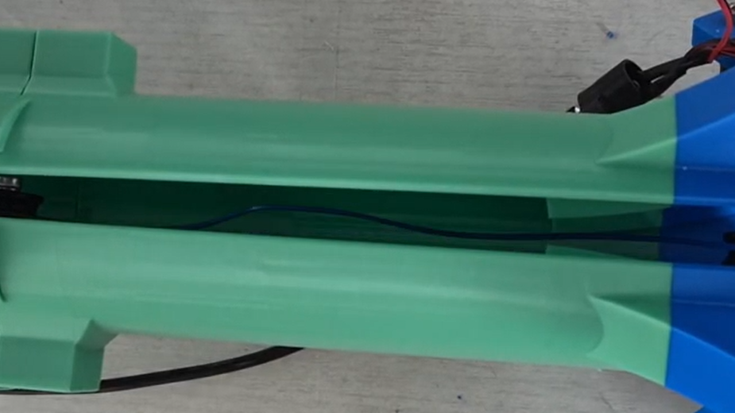
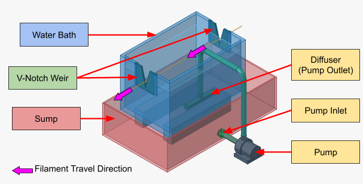
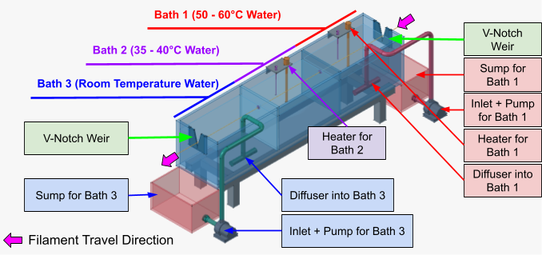

## 3.1 Problem Description {#s3-1}

Over all test extrusion runs, it was observed that the extrudate cooled into a serpentine shape upon entering the Omniflow cooling tunnel, creating lateral deviations and failing to produce a nice straight filament. This phenomena was observed to cause incoming extrudate to fall off the guide wheels and drag on the tunnel floor. This reduced airflow exposure, introduced additional frictional forces to the section of filament being dragged on the floor, thus causing asymmetric cooling from the 4 axial fans [9] and creating a negative reinforcing loop which caused the snaking to continue down the length of filament.

*Figure 3.01: Lateral snaking of filament inside the Omniflow cooling tunnel*
{: .caption}

The snake-like bends were retained even upon spooling, making this issue the top priority for rectification. Bends have been reported to interfere with filament loading and alignment at the guide entrances of 3D Printers, ultimately causing feeder skipping and under-extrusion of 3D prints [10][11].

2 factors were hypothesised to have played a part in the lateral snaking of the filament:

1.  Contamination of PCW-PP flakes (Section 3.2)
2.  Use of Air as a cooling medium (Section 3.3)

## 3.2 Flake Contamination {#s3-2}

The potential presence of foreign contaminants was suspected as a root cause for anisotropic cooling and resultant lateral snaking of the extrudate. 3 distinct classes of foreign contaminants within the PCW-PP are detailed in Table 3.01.

*Table 3.01: Possible Contaminants within PCW-PP*
{: .caption}

| Contaminant | Cause for presence | Impact |
|---|---|---|
| Thermo-oxidisers (C=O, –OH, –OOH) [12] | Diffusion of oxygen into PP surface which participates in radical reactions to form thermo-oxidisers in the polymer [13][14] | Alter molecular weight, viscosity and crystallisation behaviour [12] |
| Foreign plastics (PE, HDPE, LDPE, PET, PLA, PS, PA) [15] | Non-PP items can enter the PP stream through sorting errors and get shredded with PP [16] | Poor dispersion can create local variations in polymer extrudate [15] |
| Paper / cellulose residue [17] | Paper stickers or labels can be shredded with PP items if they are still attached, with label fragments or loose cellulose fibres remaining within the flakes post-shredding [16] | Form local inclusions and defects [17] |

An inquiry with Semula Asia (See Appendix C) revealed that the shredder used to produce the flakes was used to shred HDPE, leading to the hypothesis that HDPE would be the contaminant most likely within the PCW-PP flakes. 3 different lab experiments were conducted as shown in Table 3.02 to test for presence of contaminants.

*Table 3.02: Experimental Techniques used to identify Contaminants*
{: .caption}

| Experimental technique | Function |
|---|---|
| Fourier-Transform Infrared spectroscopy (FTIR) | Identifies characteristic absorption bands associated with chemical bonds and functional groups. Additional bands that do not correspond to PP can indicate oxidation, additives, or foreign materials. **Appendix D** lists reference FTIR bands for PP, PE (including HDPE and LDPE), PET, PLA, PS, and PA [18][19][20]. |
| Differential Scanning Calorimeter (DSC) | Measures thermal transitions in PP flake feedstock. A separate melting peak or shoulder may indicate an additional semicrystalline polymer. **Appendix E** gives the reference transition temperatures for the aforementioned polymers [21][22][23][24]. |
| ThermoGravimetric Analysis (TGA) | Measures changes in sample mass during heating under controlled atmosphere. Early mass loss may reflect moisture or other volatiles, while later mass loss may reflect polymer decomposition. Once organic fraction is removed, the remaining mass provides an estimate of inorganic residue, which may include mineral fillers. Identifying individual minerals requires a separate compositional analysis. |

FTIR identifies the polymers within the PP flakes from the absorption bands produced. Where PP and HDPE share overlapping C–H bands, DSC provides an independent check for a separate melting transition in the PE range [15]. TGA complements both techniques by measuring the residue after decomposition, which can reveal an inorganic fraction even when specific filler bands are unresolved by FTIR [15]. Sections 3.2.1 - 3.2.3 present the FTIR, DSC and TGA results, respectively. Each experiment was conducted twice to ensure consistency between experimental runs.

### 3.2.1 FTIR Testing {#s3-2-1}

Both PCW-PP spectra showed characteristic PP bands near 1375, 1167, 997 and 973 cm⁻¹, consistent with the reference fingerprint in Appendix D [18]. The spectra supported the assignment of PP as the dominant polymer. A separate PE contribution remained unresolved because of overlapping absorption bands [15]. The FTIR experimental results can be found in Appendix D.

### 3.2.2 DSC Testing {#s3-2-2}

The two PCW-PP samples showed first-heating melting peaks at 157.8 and 164.2 °C. The melting peaks were consistent with PP’s melting range [15], and the spread between runs suggests variability within feedstock. Neither DSC curve showed a separate melting peak for foreign polymer contaminants. The DSC experimental results can be found in Appendix E.

### 3.2.3 TGA Testing {#s3-2-3}

The two PCW-PP samples left final residues of 2.87 and 4.85 wt%, giving a mean of 3.86 wt%. These results support the presence of a small thermally stable inorganic fraction. Given the project timeframe, residue analysis was limited to measuring its mass by TGA. The specific minerals comprising the residue therefore remain unidentified. The TGA experimental results can be found in Appendix F.

### 3.2.4 Verdict on Contaminant Presence {#s3-2-4}

FTIR and DSC identified PP as the dominant polymer and provided no clear evidence of a separate foreign polymer phase like HDPE under the test conditions. TGA indicated a minor thermally stable inorganic fraction, whose composition and possible contribution to lateral snaking remain undetermined.

## 3.3 Air as a Cooling Medium {#s3-3}

The current EcoSpool Prototype uses moving air as the cooling medium. Following the feedstock screening detailed in Section 3.2, the team examined airflow in the Omniflow tunnel as a possible contributor to lateral snaking. Repeated anemometer readings at the tunnel entrance indicated that the wind speed blowing through the tunnel fluctuated from 5.5 to 6.4 m/s. These changes in air speed expose different regions of filament to different rates of heat removal.

If airflow cools one side of the strand faster than the other, differential shrinkage can bend the filament as it solidifies [9]. Matsuo [25] linked one-sided air quenching to a tendency for PP to curl after drawing and heat treatment. This explains the observed phenomena in the prototype, where 1 side of the extrudate was cooled faster due to being exposed to a higher wind speed than the other side, causing it to cool and contract faster. This resulted in the slower-cooling opposite side of the filament to cool around it, creating the snake-like shape of the solidified filament.

## 3.4 Proposed Solution 1: Water Bath with Temperature Zones {#s3-4}

### 3.4.1 Rationale for Water as Cooling Medium {#s3-4-1}

The lateral snaking observed motivates testing a cooling method that surrounds the PP5 strand with water. Immersion brings water into contact with the full circumference of the strand, allowing the team to test whether more even cooling reduces lateral deviation. At 28 °C, water has 23 times the thermal conductivity of air. It also absorbs more heat per unit mass and volume for the same temperature rise (Table 3.03).

*Table 3.03: Thermal properties of dry air and liquid water at selected temperatures [26, 27]*
{: .caption}

| Property | Air at 28°C | Water at 28°C | Water at 40°C | Water at 50°C | Water at 60°C |
|---|---|---|---|---|---|
| Thermal conductivity (W/m·K) | 0.0265 | 0.612 | 0.631 | 0.644 | 0.654 |
| Specific heat capacity (kJ/kg·K) | 1.007 | 4.180 | 4.179 | 4.181 | 4.185 |
| Volumetric heat capacity (kJ/m³·K) | 1.18 | 4165 | 4147 | 4131 | 4115 |

A radial model including crystallisation estimates 8–20 s to cool the strand centre to 60 °C in 28 °C water for illustrative convection coefficients of 100–500 W/(m²·K). A fully wetted 40 cm path provides 18 s.

Before fabricating the proposed prototype, the team will compare a 40 cm room-temperature still-water trough with the aligned air tunnel in three matched pairs. Screening results will inform the setup of the recirculating single-zone prototype.

*Table 3.04: Preliminary scoring to determine method of preliminary cooling trial*
{: .caption}

| Cooling concept | Low cost | Fast setup | Low strand disturbance | Temperature control | Total / 12 |
|---|---|---|---|---|---|
| Aligned air tunnel | 3 | 3 | 1 | 1 | 8 |
| Room-temperature still water | 3 | 3 | 3 | 2 | **11** |
| Recirculating single zone | 2 | 2 | 3 | 2 | 9 |
| Heated three-zone bath | 1 | 1 | 3 | 3 | 8 |

### 3.4.2 Single-Zone Proof-of-Concept Bath {#s3-4-2}

*Figure 3.02: CAD Model of Single-zone 40cm-long water bath with key parts and filament travel direction labelled. Relevant water bath data and estimated budget can be found in Appendices G and H*
{: .caption}

A single-zone bath will test whether water cooling improves filament quality on EcoSpool. The bath will be 40 cm long to match the nominal cooling length of the Omni-Flow tunnel. It will use an acrylic tank with interchangeable V-notch plates at both ends which allow different angles to be tested for minimising flow rate while maintaining filament clearance and submergence. Water overflowing from the notches drain into a common sump and return through a submerged diffuser which limits disturbance of extrudate. Water temperature, strand speed, straightness, diameter and ovality will be recorded. The single-zone results will serve as the baseline for evaluating the triple-zone bath.

### 3.4.3 Triple-Zone Water Bath {#s3-4-3}

*Figure 3.03: CAD Model of Triple-zone 1.20m-long water bath with key parts and filament travel direction labelled. Relevant water bath data and estimated budget can be found in Appendices G and H*
{: .caption}

The 3-stage bath will progressively cool the filament from a warm inlet near the die to a room-temperature outlet near the puller. The outer zones use the removable V-notch system, sump and return pump. The filament will pass through aligned holes in the acrylic dividers. A latex membrane at each divider limits water exchange around the strand. Trials will check temperature stability, leakage and filament drag at the pass-throughs. Polypropylene contracts as it cools and crystallises [30] and rapid surface solidification can create a rigid skin around a hot core, and subsequent core contraction can produce internal shrinkage voids [31]. A warmer first zone reduces initial temperature differences between filament surface and the water, moderating initial cooling [32]. 

Proposed trial ranges are 50 - 60 °C in Zone 1 and 35 - 40 °C in Zone 2. These settings are informed by warm-inlet guidance for rod extrusion and separate recycled-PP filament trials at 40 and 50 °C [32, 33]. PID-controlled heaters will regulate the first two zones. The third will operate near room temperature.

*Table 3.05: Proposed temperatures, lengths and circulation arrangements for the three-zone bath.*
{: .caption}

| Zone | Proposed water temperature (°C) | Bath length (cm) | Water circulation arrangement |
|---|---|---|---|
| Nearest to die | 50–60 | 40 | Heater, sump and return pump |
| Middle bath | 35–40 | 40 | Heater in static water |
| Nearest to spooler | 28 (room temp.) | 40 | Sump and return pump |

The proposed 1.20m bath uses 3 40cm modules. This matches the module length of the single-zone prototype and gives each zone a nominal residence time of 18.0s per bath at 1.33 m/min when the filament is fully submerged.
