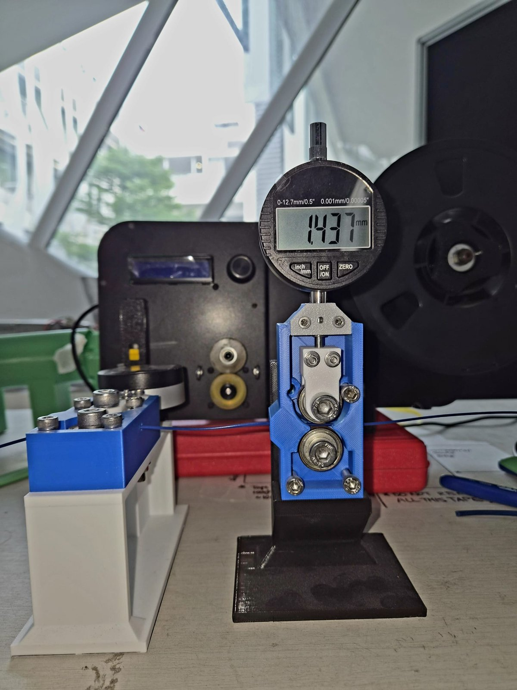
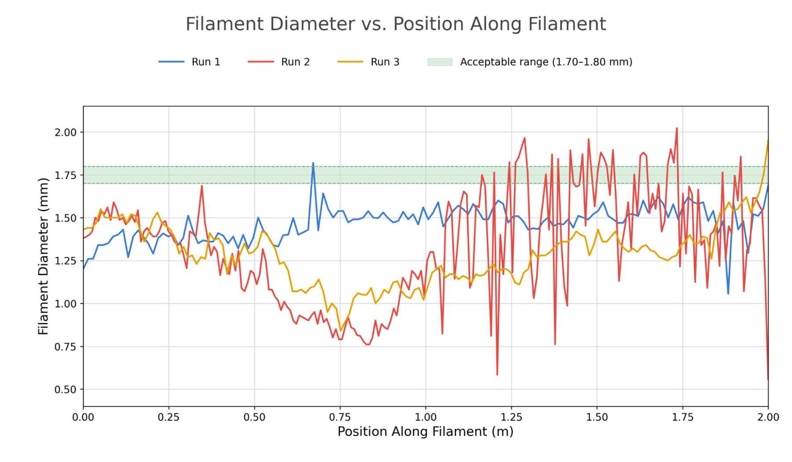
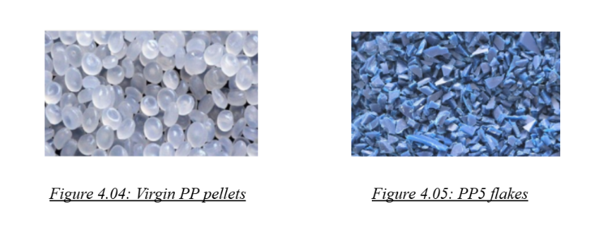
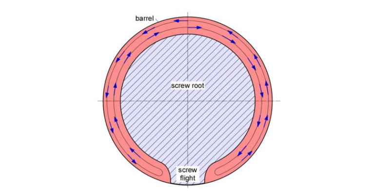
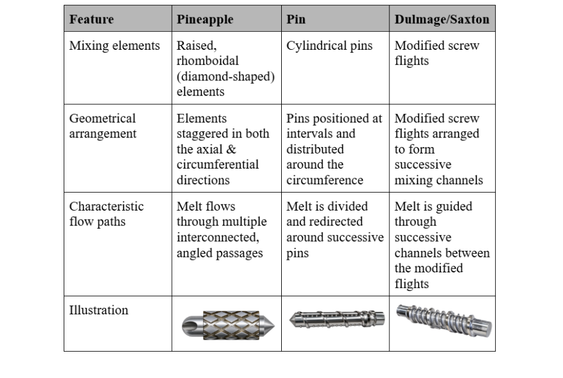
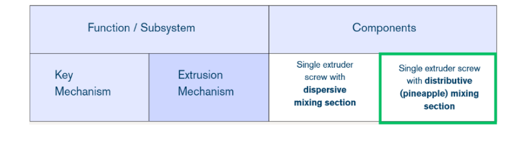
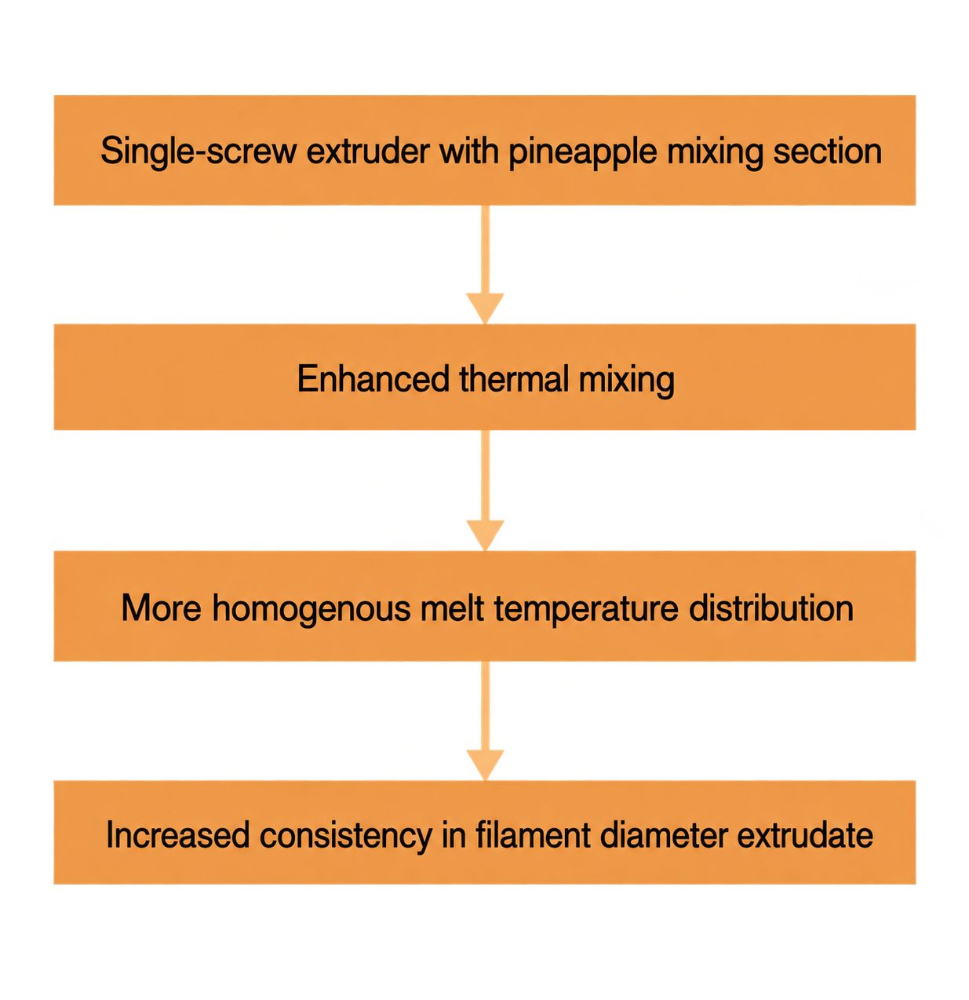

## 4.1 Problem Description {#s4-1}

### 4.1.1 Filament Diameter Metric {#s4-1-1}

The nominal filament diameter for 3D printing applications defined by commercial standards is 1.75mm [34]. In practice, filament doesn’t adhere perfectly to these ideal specifications, and minor deviations are acceptable. As mentioned in Section 1.2, the specified tolerance range for PP is ±0.05 mm [35], and the corresponding acceptable diameter range is 1.70 mm to 1.80 mm.

*Table 4.01: Dimensional Specifications for PCW-PP Filament*
{: .caption}

| Parameter | Description | Specification |
|---|---|---|
| Nominal filament diameter | Target diameter for 3D printing filament | 1.75 mm |
| Tolerance range | Maximum allowable deviation from the nominal diameter | ± 0.05 mm |
| Acceptable diameter range | Permissible diameter range along the entire extruded filament length | 1.70–1.80 mm |

Several issues arise during 3D printing when filament diameter falls outside the acceptable range as shown in Table 4.02 [36]:

*Table 4.02: Effects of Filament Diameter Deviations on 3D printing*
{: .caption}

| Filament diameter | Feeding behaviour | Impact on 3D printing |
|---|---|---|
| Below 1.70 mm (undersized) | The drive gears may fail to grip, causing slippage and reducing the amount of material fed into the nozzle. In severe cases, filament can buckle or break during feeding, disrupting the printing process entirely. | **Under-extrusion:** increased void formation, poor surface finish and reduced structural strength of the printed component |
| Above 1.80 mm (oversized) | Increased friction within the feeding path, potentially causing jamming and interrupting the printing process | **Over-extrusion:** excessive material deposition would result in uneven material deposition and dimensional inaccuracies in the printed component |

### 4.1.2 Observed problem {#s4-1-2}

During preliminary extrusion trials with the existing EcoSpool system, the molten PP extrudate exhibited alternating thick and thin sections immediately after exiting the die. These visible diameter variations raised concerns about the dimensional consistency of the resulting filament.

*Figure 4.01: Inconsistencies in filament diameter*
{: .caption}

However, visual inspection alone was insufficient to quantitatively assess filament diameter consistency. Therefore, a diameter consistency test was performed to quantify diameter variations along the selected filament length and determine the percentage of measurements within the acceptable range.

### 4.1.3 Experimental evaluation {#s4-1-3}

The dimensional consistency of the cooled PP filament was evaluated through three independent extrusion runs using PCW-PP flakes as the feedstock. Multiple runs were conducted to account for potential run-to-run variability and assess the repeatability of the observed diameter fluctuations, thereby improving the reliability of the findings.

All three runs were conducted under identical operating conditions established by the previous EcoSpool project team (Table 4.03). These conditions were maintained to minimise the influence of process parameters on filament diameter variations, allowing for a more reliable comparison across runs.

*Table 4.03: Experiment Parameters*
{: .caption}

| Process parameters | Operating conditions |
|---|---|
| Compression screw ratio (single-screw extruder) | 3.5:1 |
| Screw rotational speed | 2 rpm |
| Filament puller speed | 1.33 m/min |
| Barrel temperature profile (3 heating zones) | 155 °C - 165 °C - 170 °C |
| Feedstock | PCW-PP flakes |

Following the three extrusion runs, a 2m filament sample from each run was selected for diameter measurements using two in-line dial gauges positioned perpendicular to each other (Fig 4.02). Horizontal and vertical readings were recorded and averaged to obtain a single diameter value at every point along the filament. These values were used to calculate the mean diameter, standard deviation and percentage of filament within the acceptable diameter range (Appendix I). The results were then tabulated in Table 4.04 for further analysis.

*Figure 4.02: Dial gauges set-up for diameter measurements*
{: .caption}

*Figure 4.03: PCW-PP Filament Diameter vs Position along Filament*
{: .caption}

*Table 4.04: Tabulation of Diameter consistency experiment results*
{: .caption}

| | Minimum diameter (mm) | Maximum diameter (mm) | Mean diameter (mm) | Standard deviation of diameter (mm) | Percentage within acceptable diameter range (%) |
|---|---|---|---|---|---|
| Run 1 | 1.056 | 1.820 | 1.467 | 0.100 | 0.00 |
| Run 2 | 0.558 | 2.022 | 1.334 | 0.325 | 5.31 |
| Run 3 | 0.840 | 1.950 | 1.287 | 0.178 | 0.63 |

Standard deviation was used as the primary measure of filament diameter consistency, as it quantified the spread of diameter measurements around their mean.  However, lower variation does not necessarily indicate suitability for 3D printing. Although Run 1 had the lowest standard deviation (0. 100 mm), none of its measurements fell within the acceptable range.

Across the three runs, mean diameters ranged from 1.287 to 1.467 mm, corresponding to deviations of 0.283–0.463 mm below the nominal diameter of 1.75 mm. Only 0.00–5.31% of measurements met the acceptable range, highlighting the importance of considering both diameter consistency and accuracy.

Despite identical operating settings, the standard deviation more than tripled from Run 1 (0.100 mm) to Run 2 (0.325 mm), while the mean diameter decreased from 1.467 mm in Run 1 to 1.287 mm in Run 3. These differences reveal considerable run-to-run variability alongside the diameter fluctuations observed within individual samples.

## 4.2 Root cause analysis {#s4-2}

The experimental findings in Section 4.1.3 warranted further investigation into the potential factors behind extrudate diameter inconsistencies.

### 4.2.1 Hypothesis : Non-homogeneous melt temperature distribution {#s4-2-1}

Based on initial literature review, non-homogeneous melt temperature distribution was identified as a key factor. Trienens et al. (2023) noted that insufficient thermal homogeneity can cause differences in melt velocities across the die exit, potentially reducing extrudate’s dimensional accuracy [37].

Higher-temperature regions of the PP melt generally exhibit lower viscosity and flow more readily, while cooler regions have higher viscosity and greater resistance to flow. If the temperature distribution varies over time, the corresponding changes in localised flow resistance can alter average melt velocity at the die exit. Assuming incompressible flow through a die of constant cross-sectional area [38], the continuity equation relates changes in average melt velocity to fluctuations in volumetric flow rate (Appendix J). With filament puller speed fixed throughout the experiments, fluctuations in volumetric flow rate translate into inconsistencies in filament diameter.

### 4.2.2 Influence of PP feedstock characteristics on heating uniformity {#s4-2-2}

We identified that two inherent characteristics of the PP feedstock could contribute to the non-homogeneous melt temperature distribution: Irregular geometry of PCW-PP flakes and its low thermal conductivity.

1) Irregular geometry of PP flakes

We selected shredded PCW-PP flakes as feedstock to avoid an additional thermal cycle and minimise thermal degradation, keeping it in the recycling loop longer. Unlike conventional PP pellets with relatively uniform geometries, these flakes vary in shape, size and thickness, resulting in inconsistent packing within the screw channel [39], creating variations in contact area between neighbouring flakes, leading to uneven heat transfer during melting. Additionally, thicker flakes require more time to heat due to the greater distance over which heat must penetrate.

Consequently, variations in flake thickness and thermal contact can cause unequal heating rates among flakes, contributing to localised temperature differences throughout the PP during melting.

*Figure 4.04: Virgin PP pellets (left). Figure 4.05: PCW-PP flakes*
{: .caption}

2) Low thermal conductivity of PP

Due to the relatively low thermal conductivity (0.11-0.22 W/m·K) [40], PP exhibits high resistance to conductive heat transfer, limiting the rate at which heat spreads radially from the heated barrel wall into the melt. PP melt near the heated barrel wall may reach the target temperatures more readily, while regions near the screw root remain cooler, creating radial temperature gradients.

### 4.2.3 Thermal mixing capability of existing conventional single-screw extruder {#s4-2-3}

Although PP feedstock characteristics discussed in Section 4.2.2 contribute to temperature differences during melting, effective thermal mixing can mitigate them. Accordingly, we examined the existing conventional single-screw extruder to evaluate its ability to homogenise melt temperature distribution before the die exit.

In a conventional single-screw extruder, screw rotation generates vortical cross-channel circulation, allowing some rearrangement of the PP melt. However, this circulation tends to follow a relatively predictable flow pattern, limiting repeated redistribution of material among the different regions along the screw channel. As a result, hotter and cooler portions of the melt remain insufficiently mixed, allowing temperature differences to persist even when melt approaches the die exit [41].

*Figure 4.06: Cross-channel melt circulation in a single-screw extruder [42]*
{: .caption}

## 4.3 Proposed Solution 2: Single-screw extruder with pineapple mixing section {#s4-3}

The root-cause analysis in Section 4.2 highlighted the need for additional thermal mixing beyond the capabilities of the existing single-screw extruder. Hopmann et al. (2020) emphasised the role of specially designed mixing elements in modifying melt-flow patterns to promote more effective thermal mixing [43]. As such, we proposed incorporating a dedicated mixing section into a conventional single-screw extruder.

### 4.3.1 Mixing sections : Dispersive vs Distributive {#s4-3-1}

Mixing sections in polymer extrusion are generally classified into two categories:

1.  Dispersive mixing
2.  Distributive mixing

The functions and mechanisms for both the mixing sections are summarised in the table below [44]:

*Table 4.05: Principles of Dispersive & Distributive mixing*
{: .caption}

| Aspect | Dispersive mixing | Distributive mixing |
|---|---|---|
| Primary function | **Breaks down agglomerates** into smaller particles for **better dispersion** throughout the polymer melt. Agglomerates: pigments, fillers, unmelted gels | **Enhances the uniformity** of the polymer melt, particularly in terms of **temperature and/or composition** |
| Mixing mechanism | Forces the polymer melt through narrow gaps, generating **high shear stresses** to break down agglomerates | **Repeatedly divides, rearranges and recombines** different portions of the polymer melt to promote a more uniform distribution |

We concluded that the distributive mixing section was optimal for incorporation into a single-screw extruder because it promotes the repeated redistribution of hotter and cooler regions. This makes it particularly well-suited for improving thermal mixing.

### 4.3.2 Comparison of distributive mixing sections {#s4-3-2}

Three established distributive mixing configurations were considered for further evaluation [45]:

1.  Pineapple (diamond-shaped) mixing
2.  Pin mixing
3.  Dulmage/Saxton mixing

Although all three facilitate melt redistribution, they differ in their geometries and the melt flow paths created within the mixing sections (See Table 4.06).

*Table 4.06: Comparison of Distributive mixing sections*
{: .caption}

Among the three designs compared in Table 4.06, the pineapple mixing section was selected for further evaluation due to its staggered rhomboidal elements, which create multiple interconnected, angled passages. These features were considered suitable for promoting continuous changes in melt flow direction and redistribution of material across the screw channel, potentially improving thermal homogeneity.   

*Table 4.07: Morphological chart with selected solution (highlighted in green)*
{: .caption}

- The proposed extruder screw should incorporate a pineapple mixing section near the screw tip, within the metering zone, where the PP is predominantly molten [46].
- The proposed screw configuration is illustrated in the CAD drawing and reference photograph provided in Appendix K.

### 4.3.3 Operating principles of pineapple mixing section {#s4-3-3}

Upon entering the mixing section, the PP melt is divided and redirected through multiple interconnected flow passages formed by the staggered rhomboidal elements. The resulting changes in flow direction and velocity induce shear and extensional deformation, making the hotter and cooler regions thinner and more elongated [47].

These deformed regions are subsequently redirected and rearranged as they pass through successive mixing elements, promoting a finer distribution of hotter and cooler regions throughout the PP melt. The shorter heat conduction distance facilitates faster thermal diffusion, enhancing thermal mixing within the PP melt (Appendix L).

The expected effect of enhanced thermal mixing on extrudate diameter consistency is illustrated below:

*Figure 4.07: Expected outcome workflow of installation of Single-screw pineapple mixing screw*
{: .caption}
