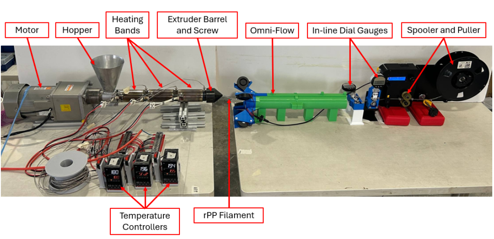
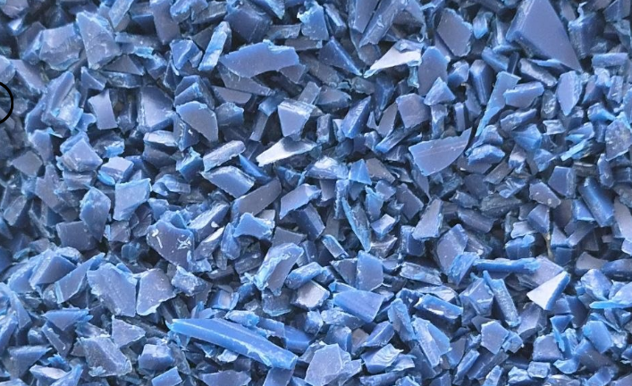
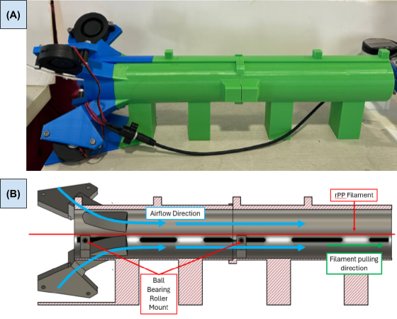
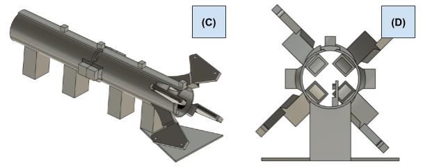
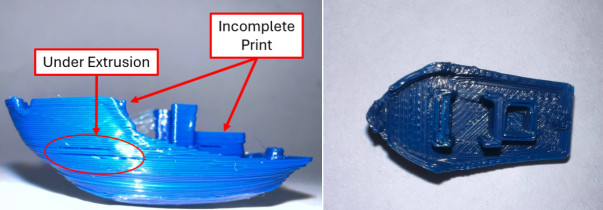

## 2.1 Overview of Existing Prototype {#s2-1}

EcoSpool implements the direct extrusion route outlined in Figure 1.02, skipping the pelletisation phase. This configuration explained in the subsequent Section 2.2 provides the starting point for producing usable 1 kg spools of filament consistently within diameter specifications.

*Figure 2.01: Labelled diagram of existing EcoSpool prototype [8]*
{: .caption}

## 2.2 Process Workflow {#s2-2}

### 2.2.1 Feedstock Preparation {#s2-2-1}

Waste PP products are collected and the shredding process is outsourced to Semula Asia. The PCW-PP is then collected back in the form of flakes.

*Figure 2.02: PCW-PP flakes post-shredding*
{: .caption}

### 2.2.2 Feeding, Melting and Extrusion {#s2-2-2}

A single screw conveys and compacts the flakes as they melt in the barrel. The previous team selected a 3.5:1 compression ratio after observing better melt distribution in its mixing test than a 4:1 screw. The screw ran at 2 rpm during integrated validation.

The barrel uses resistance band heaters across three zones. For PCW-PP, the previous team selected setpoints of 155, 165 and 170 °C from the hopper to the die. In its temperature trials, this profile gave a lower standard deviation in cross-sectional area than the 145–155–160 °C profile (0.47 versus 0.77 mm²).

The die outlet has a specified diameter of 1.75 mm. The strand continues to change dimensions during drawing and cooling, and the integrated trial recorded substantial variation along the finished filament, as detailed in Section 2.3.

### 2.2.3 Cooling and Filament Guidance {#s2-2-3}

The 40 cm Omni-Flow tunnel uses four centrifugal fans to direct air predominantly along the filament axis. The arrangement was designed to cool the strand more evenly around its circumference, while a ball-bearing roller supports the soft filament inside the tunnel.

*Figure 2.03: (A) Side-profile view and (B) Cross-sectional Side-profile view of Omniflow wind tunnel in real life and CAD respectively*
{: .caption}

*Figure 2.04: (A) Isometric and (B) Rear view of Omniflow wind tunnel in CAD*
{: .caption}

### 2.2.4 Pulling and Spooling {#s2-2-4}

The puller draws the strand through the cooling tunnel, and the spooler winds the cooled filament. The previous team held the pull speed at 1.33 m/min (0.0222 m/s) while varying the cooling air speed. The previous report associates this baseline pull speed with a nominal production rate of 173 g/h [8].

## 2.3 Demonstrated Performance and Refinement Priorities {#s2-3}

The integrated validation assessed 2.5 m filament samples. For PCW-PP, an air speed of 4.9 m/s gave the lowest diameter standard deviation and mean ovality among the speeds tested. At this setting, the measured diameter still ranged from 1.38 to 1.99 mm, extending beyond both limits of the previous team’s 1.65–1.85 mm acceptance band.

*Table 2.01: Dimensions of the extruded PP filament as measured by the previous team [8]. rPP refers to virgin PP that was extruded, flattened and cut into flakes to mimic PCW-PP*
{: .caption}

| Filament properties | rPP | PCW-PP |
|---|---|---|
| Mean diameter (mm) | 1.74 | 1.63 |
| Max diameter (mm) | 1.87 | 1.99 |
| Min diameter (mm) | 1.53 | 1.38 |
| Diameter deviation range, max − min (mm) | 0.34 | 0.61 |
| Standard deviation of diameter (mm) | 0.088 | 0.137 |
| Mean ovality (mm) | 0.075 | 0.092 |
| Max ovality (mm) | 0.24 | 0.32 |

The previous team successfully printed small architectural components with the  filament. During a 3DBenchy test, however, a locally thick section jammed the printer and stopped the print midway [8]. The prototype thus demonstrated that it could produce printable lengths of PCW-PP filament, while showing that rectifications to the current prototype setup were necessary in order to produce a workable 3DP filament spool.

*Figure 2.05: Side and Top views of incompletely printed 3D Benchy [8]*
{: .caption}

During present project’s trials, 2 main problems were observed and will be explored in-depth in Sections 3 and 4:

1.  Extrudate was observed to snake laterally as it passed through Omniflow tunnel, making the strand difficult to guide along the intended path (Section 3).
2.  Alternating regions of thickening and thinning extrudate were observed at the die exit, with sections of cooled filament being thinner than intended (Section 4).
